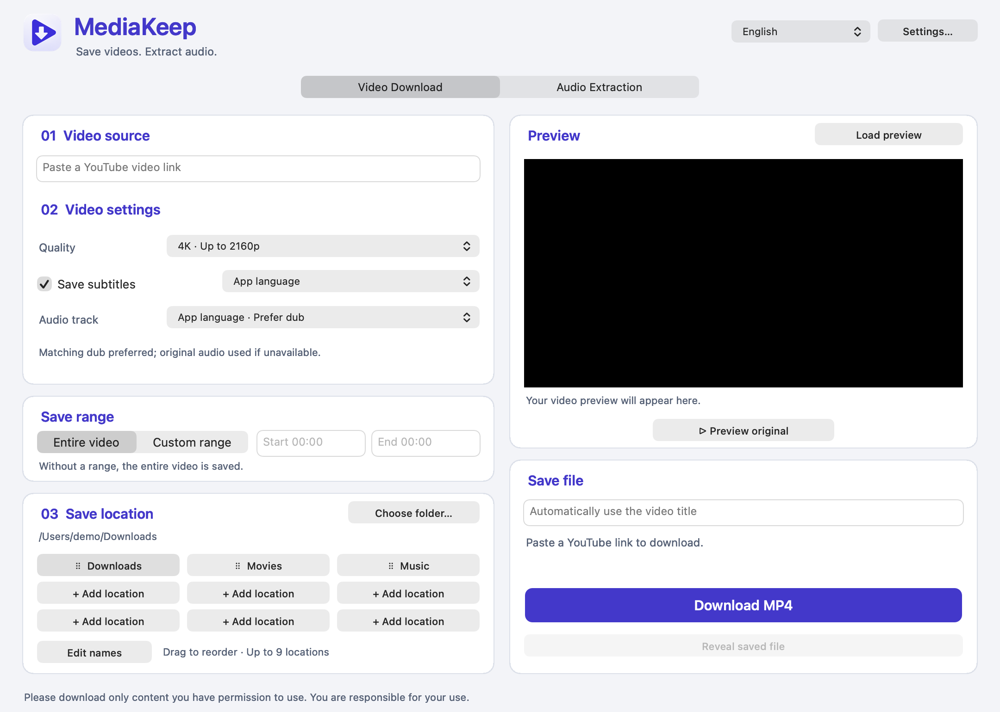
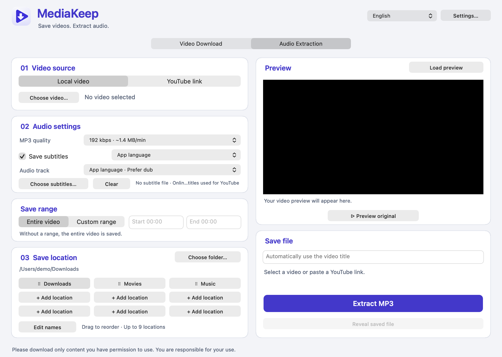
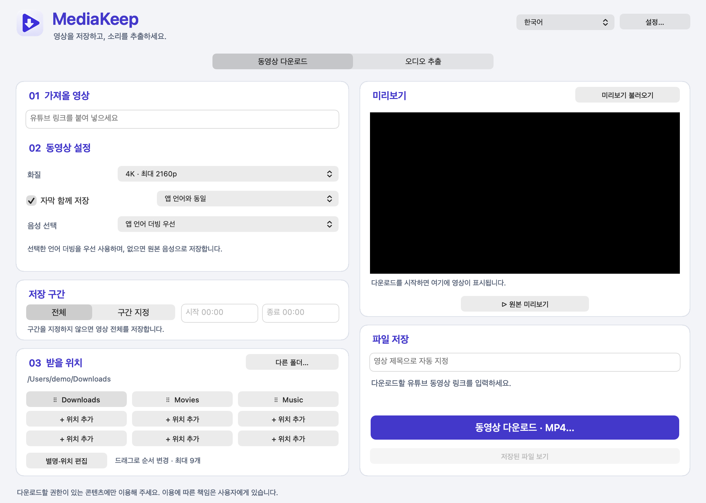
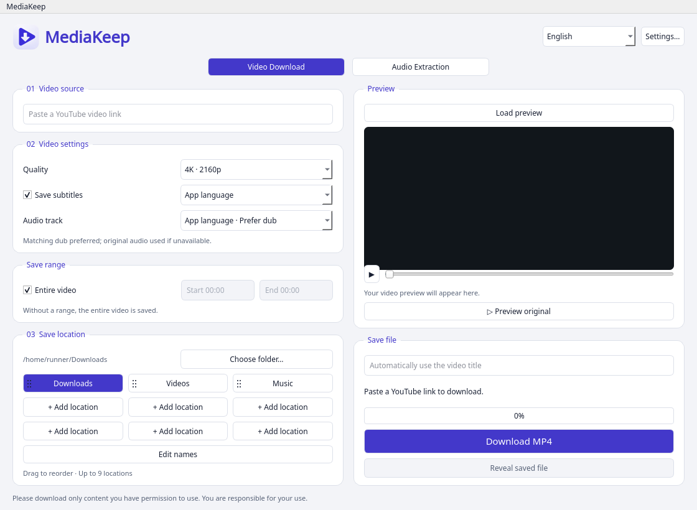
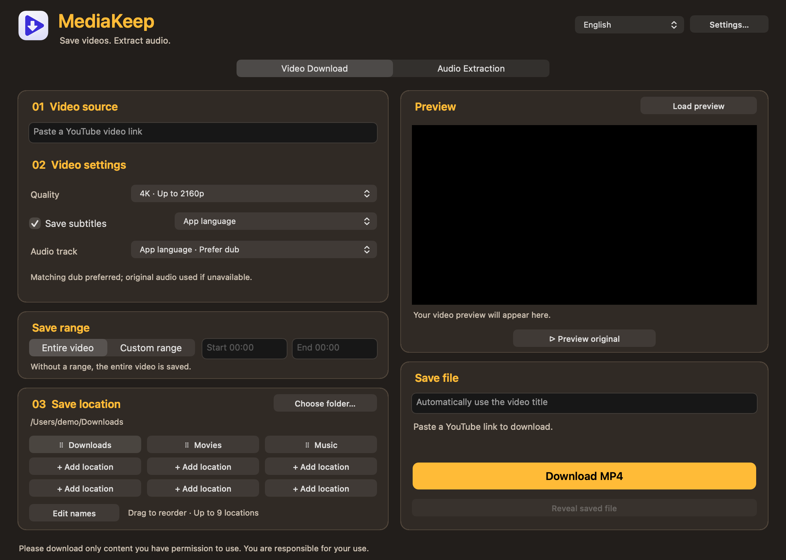

<p align="center"></p>

# MediaKeep 1.0.0

**영상은 MP4로, 소리는 MP3로. 필요한 구간과 자막을 한곳에 저장하는 무료 데스크톱 도구입니다.**

사과공방 **Apple Craft** · 개발자 **최귀동 / Choi Kuidong** · [홈페이지](https://applecraft.kr)

이 저장소는 20개 언어와 macOS·Windows·Linux 지원을 기준으로 **1.0.0부터 새로 시작**합니다. 이전 담아컷 / MediaKeep 1.2.x 사용자는 이번 1.0.0을 직접 설치해 주세요. 기존 앱의 숫자 버전 비교에서는 1.0.0이 낮게 인식됩니다. 새 버전의 업데이트 확인은 1.0.0 이후 릴리스를 대상으로 동작합니다.

[English user guide](docs/README.en.md) · [최신 다운로드](https://github.com/Choikuidong/MediaKeep/releases/latest)

## 실제 프로그램 화면

아래는 1.0.0 앱을 직접 실행해 캡처한 화면입니다. 미디어를 선택하기 전 화면이므로 미리보기 영역은 비어 있습니다.

### macOS · 동영상 다운로드



### macOS · 오디오 추출



### 한국어로 전환한 화면



### Windows · 실제 실행 화면


### Linux · 실제 실행 화면



## 내 컴퓨터에 맞게 다운로드

[최신 배포 파일과 변경 내용 보기](https://github.com/Choikuidong/MediaKeep/releases/latest)

| 운영체제 | 파일 | 사용 방법 |
|---|---|---|
| macOS 13 이상 · Apple Silicon M1 이상 | `MediaKeep-1.0.0-macOS-arm64.dmg` | DMG를 열고 MediaKeep을 응용 프로그램 폴더로 이동 |
| Windows 10/11 · 64비트 x86-64 | `MediaKeep-1.0.0-Windows-x64.zip` | 압축을 모두 푼 뒤 폴더 안의 `MediaKeep.exe` 실행 |
| Linux · x86-64 · Ubuntu 22.04 이상 기준 | `MediaKeep-1.0.0-Linux-x86_64.tar.gz` | 압축을 풀고 폴더 안의 `MediaKeep` 실행 |

macOS Intel, Windows ARM64, Linux ARM64용 배포 파일은 포함하지 않습니다. Python, FFmpeg, yt-dlp, Deno를 별도로 설치할 필요가 없도록 배포본에 필요한 실행 구성요소를 포함합니다.

## 이런 일을 할 수 있습니다

| 원하는 작업 | 사용하는 기능 | 저장 결과 |
|---|---|---|
| 사용 권한이 있는 온라인 영상 보관 | **Video Download**에서 YouTube 링크 입력 | MP4 영상 |
| 내 동영상에서 소리만 추출 | **Audio Extraction → Local video** | MP3 음원 |
| 온라인 영상에서 음원만 보관 | **Audio Extraction → YouTube link** | MP3 음원 |
| 긴 영상에서 일부 구간만 저장 | **Entire video** 대신 범위 지정 | 해당 구간의 MP4 또는 MP3 |
| 자막을 영상과 함께 보관 | **Save subtitles** 켜기 | MP4 선택형 자막 및 별도 SRT |
| 가사 표시가 가능한 플레이어에서 자막 사용 | 오디오 추출 시 자막 저장 | MP3 + SRT + LRC |
| 해당 언어로 제공되는 더빙 음성 사용 | **Audio track** 언어 선택 | 제공된 언어 음성을 포함한 영상·음원 |
| 자주 쓰는 저장 폴더로 빠르게 이동 | 저장 위치 단축 버튼 | 최대 9개 폴더 및 별명 |

### 화질과 음질

- 동영상 화질은 **4K · 최대 2160p**가 기본입니다. Full HD 1080p, HD 720p, SD 480p도 선택할 수 있습니다.
- 원본이 1080p라면 4K를 선택해도 가능한 최고 화질인 1080p로 저장합니다. 원본에 없는 해상도를 새로 만드는 기능은 아닙니다.
- MP3 음질은 **320 / 192 / 128 kbps** 중 선택하며 기본은 192 kbps입니다. 높은 음질일수록 용량이 큽니다.
- 구간을 선택하지 않으면 **영상 전체**를 저장합니다. 구간 저장을 사용해도 온라인 원본을 먼저 내려받을 수 있으므로, 다운로드 데이터 사용량이 구간 길이만큼 줄어든다는 뜻은 아닙니다.

### 자막과 더빙은 어떻게 동작하나요?

1. 프로그램의 기본 언어는 영어입니다. 우측 상단에서 원하는 언어로 바꿀 수 있습니다.
2. 자막의 **App language**는 현재 프로그램 언어를 따라갑니다. 별도로 다른 언어를 선택할 수도 있습니다.
3. **Audio track → App language · Prefer dub**는 해당 언어의 제공된 더빙 음성을 우선합니다.
4. 원하는 더빙이 없으면 원본 표시 음성을 우선하고, 원본 표시가 없으면 가능한 음성을 선택합니다.
5. 자막이나 더빙이 없는 영상도 있습니다. 자막을 가져오지 못한 경우 미디어만 저장하며 상태 문구로 안내합니다.
6. 오디오 추출에서는 사용자가 고른 SRT/VTT/ASS/SSA 자막 파일을 우선 사용할 수 있습니다.
7. 구간을 잘라 저장하면 자막 시간도 새 파일의 시작점에 맞게 조정합니다.

**이 앱은 AI 번역 자막이나 더빙을 새로 생성하지 않습니다.** 원본 서비스에 실제로 제공되는 음성·자막을 선택하고, 가져온 자막을 필요한 형식으로 변환합니다. 자동 자막은 원본 서비스의 인식·번역 정확도에 영향을 받습니다.

## 지원 언어 — 총 20개

| | | | |
|---|---|---|---|
| English | 한국어 | 日本語 | 简体中文 |
| 繁體中文 | Español | Français | Deutsch |
| Português (Brasil) | Italiano | Русский | Bahasa Indonesia |
| Nederlands | Polski | Türkçe | Українська |
| Tiếng Việt | Svenska | Čeština | Română |

화면, 주요 작업 상태, 업데이트 안내 및 앱 자체 오류 문구를 번역했습니다. 영상 제목·사용자 별명·운영체제 파일 선택 창·외부 도구의 원문 오류·GitHub 릴리스 본문은 자동 번역하지 않습니다. 언어 설정은 다음 실행에도 유지됩니다.

## 설치 방법

### macOS

1. 기존 MediaKeep 또는 담아컷을 종료합니다.
2. Mac용 DMG를 다운로드하고 엽니다.
3. **MediaKeep.app**을 **Applications / 응용 프로그램** 폴더로 드래그합니다.
4. 응용 프로그램 폴더에서 실행합니다. 설치 후 DMG는 추출해도 됩니다.
5. 현재 배포본은 로컬 서명이며 Apple Developer ID 서명·공증이 포함되지 않습니다. 첫 실행이 차단되면 파일 출처를 확인한 뒤 macOS **시스템 설정 → 개인정보 보호 및 보안**의 해당 앱 안내를 확인해 주세요.

기존 담아컷에서 사용한 폴더 단축키와 설정을 이어받을 수 있도록 기존 macOS 번들 식별자를 유지했습니다. 앱 파일은 MediaKeep 이름을 사용합니다.

### Windows

1. Windows용 ZIP을 다운로드합니다.
2. ZIP을 오른쪽 클릭하고 **모두 압축 풀기**를 선택합니다.
3. 풀린 `MediaKeep` 폴더 안의 **MediaKeep.exe**를 실행합니다.
4. 원하면 바로가기를 만들어 바탕 화면에 놓습니다.
5. `MediaKeep.exe`만 다른 곳으로 옮기지 마세요. 옆의 `_internal` 폴더가 필요합니다.

Windows용은 관리자 권한 설치가 필요 없는 포터블 배포본입니다. 현재 코드 서명 인증서는 포함되지 않으므로 Windows에서 처음 실행할 때 게시자 확인 안내가 나타날 수 있습니다. 업데이트할 때는 앱을 종료하고 새 ZIP을 별도 폴더에 모두 푼 뒤 실행해 주세요.

### Linux

파일 관리자에서 압축을 풀고 `MediaKeep` 파일을 실행하거나 터미널에서 다음과 같이 실행합니다.

```sh
tar -xzf MediaKeep-1.0.0-Linux-x86_64.tar.gz
cd MediaKeep
./MediaKeep
```

배포본의 기본 대상은 Ubuntu 22.04 이상과 호환되는 x86-64 데스크톱 환경입니다. GUI 세션이 필요합니다. 배포판에 따라 Qt 화면·오디오 라이브러리가 추가로 필요할 수 있습니다. Ubuntu에서는 다음을 확인해 주세요.

```sh
sudo apt-get update
sudo apt-get install libegl1 libopengl0 libxcb-cursor0 libxkbcommon-x11-0 libpulse0 libnss3 libasound2
```

## 처음 사용하는 분을 위한 순서

### 동영상 저장하기

1. 위쪽 **Video Download** 탭을 선택합니다.
2. YouTube 영상 링크를 붙여 넣습니다.
3. **Load preview**를 눌러 제목과 미리보기를 확인합니다. 원본 페이지는 **Preview original**로 열 수 있습니다.
4. 화질, 자막 언어, 음성 언어를 선택합니다.
5. 전체를 받으려면 **Entire video**를 유지합니다. 일부만 저장하려면 범위를 지정하고 시작·종료 시간을 입력합니다. 예: 시작 `01:20`, 종료 `02:45`.
6. **Choose folder…**에서 미리 저장할 폴더를 고릅니다.
7. 자동으로 제안된 영상 제목을 확인하거나 파일 이름을 수정합니다.
8. **Download MP4**를 누릅니다. 진행률과 상태를 확인할 수 있으며 진행 중 취소도 가능합니다.
9. 완료되면 **Reveal saved file**을 눌러 저장된 파일 또는 파일이 있는 폴더를 엽니다.

### MP3로 저장하기

1. **Audio Extraction** 탭을 선택합니다.
2. **Local video**에서 내 동영상 파일을 선택하거나 **YouTube link**에 링크를 입력합니다.
3. MP3 음질을 고릅니다.
4. 필요하면 자막 파일을 직접 선택하고 **Save subtitles**를 켭니다.
5. 저장 위치와 파일 이름을 확인한 뒤 **Extract MP3**를 누릅니다.

### 저장 위치 9개를 편하게 쓰기

- **+ Add location**으로 폴더를 등록합니다. 폴더 선택 창에서 새 폴더를 만들 수도 있습니다.
- 등록한 폴더 버튼을 누르면 그 위치가 저장 대상이 됩니다.
- **Edit names**에서 별명을 수정합니다. 별명을 비우면 실제 폴더 이름을 표시합니다.
- 등록 해제는 단축 버튼만 지우며, 실제 폴더나 파일을 삭제하지 않습니다.
- 버튼의 점 모양 손잡이를 드래그해 순서를 바꿀 수 있습니다.

## 네 가지 화면 색상

**Settings → Appearance**에서 바꿉니다. 기본값은 **Soft Light**입니다.

| 테마 | 느낌 |
|---|---|
| Midnight Blue | 남색 배경과 파란 강조색 |
| Warm Amber | 따뜻한 먹색 배경과 호박색 강조 |
| Soft Light | 밝은 회색·흰색 배경과 인디고 강조 |
| Forest Green | 짙은 초록 배경과 민트 강조 |

### 네 가지 테마 실제 화면

| Midnight Blue | Warm Amber |
|---|---|
|  |  |
| **Soft Light · 기본** | **Forest Green** |
|  |  |

## 운영체제별 화면과 미리보기

macOS는 AppKit 기반 네이티브 앱, Windows·Linux는 Qt 기반 데스크톱 앱입니다. 기능과 저장 형식을 맞췄으며 운영체제에 따라 대화상자·글꼴·재생 컨트롤 모양이 다를 수 있습니다. macOS는 다운로드 중 받은 데이터에서 짧은 무음 샘플을 표시할 수 있고, Windows·Linux는 원본 썸네일과 진행률을 표시하며 저장 후 파일을 앱 안에서 재생할 수 있습니다. 온라인 **Preview original**은 브라우저에서 원본을 엽니다.

## 업데이트

- 앱 실행 시, 그리고 앱이 실행 중인 동안 하루에 한 번 GitHub 정식 릴리스를 확인합니다.
- 메뉴의 **Check for Updates…**로 바로 확인할 수 있습니다.
- 새 버전 안내에서 다운로드, 나중에, 이 버전 건너뛰기를 선택할 수 있습니다.
- 소스 파일이 바뀌었다는 이유만으로 알리지 않습니다. 더 높은 숫자의 **정식 Release**와 해당 운영체제의 배포 파일이 있어야 합니다.
- 다운로드 후 앱 교체는 사용자가 진행합니다. 앱이 종료된 동안 동작하는 별도 상주 프로그램은 설치하지 않습니다.

## 자주 묻는 질문

**4K를 골랐는데 1080p로 저장됐어요.**
원본에서 제공하는 화질이 다르기 때문입니다. 선택한 최대 해상도 이하의 가능한 화질을 사용합니다.

**한국어를 골랐는데 원래 음성이 나와요.**
원본에 한국어 더빙 트랙이 없으면 원본 음성으로 대체됩니다. 프로그램 언어를 바꾸는 것만으로 새 더빙이 생기지 않습니다.

**자막이 안 나와요.**
제공되는 자막 언어를 확인하고 Save subtitles를 켜 주세요. 자동 자막 제공 여부, 로그인 제한, 서비스 변경 등에 따라 가져오지 못할 수 있습니다. MP4 선택형 자막은 재생 프로그램의 자막 메뉴에서 켜야 합니다. SRT 파일도 별도로 확인해 주세요.

**다운로드가 실패해요.**
링크가 공개적으로 접근 가능한 단일 영상인지, 인터넷이 연결되어 있는지 확인해 주세요. DRM, 유료·비공개·로그인·연령·지역 제한을 해제하는 기능은 제공하지 않습니다. 서비스 변경이 원인일 수 있으므로 새 릴리스가 있는지도 확인해 주세요.

**같은 파일 이름이 이미 있으면 어떻게 되나요?**
덮어쓰기 전에 확인합니다. 내 동영상 또는 직접 선택한 원본 자막 파일과 같은 경로로 저장하려는 작업은 차단합니다. 임시 파일에서 처리한 뒤 완료된 결과를 저장합니다.

**윈도우나 리눅스 설정이 Mac과 동기화되나요?**
아니요. 언어, 테마, 폴더 단축키는 각 컴퓨터에 로컬로 저장됩니다. 계정 생성이나 클라우드 동기화는 필요하지 않습니다.

## 개발자를 위한 빌드

### macOS · Apple Silicon

Xcode Command Line Tools, Python 3 및 인터넷 연결이 필요합니다.

```sh
bash scripts/build.sh
bash scripts/package.sh
```

### Windows / Linux · x86-64

대상 운영체제에서 Python 3.12를 사용합니다. 다른 운영체제의 실행 파일로 이름만 바꾸는 방식이 아닙니다.

```sh
python -m venv .venv
# Windows: .venv\Scripts\activate
# Linux: source .venv/bin/activate
python -m pip install -r Desktop/requirements.txt
python Desktop/build.py
```

Windows·Linux는 GitHub Actions의 **Build Windows and Linux** 작업으로도 생성할 수 있습니다. 각각의 운영체제 러너에서 소스 검사, 실제 변환 검사, 화면 렌더링, 패키징 및 완성된 실행 파일 검사를 수행합니다.

## 배포 전 확인한 항목

| 대상 | 확인 내용 |
|---|---|
| macOS Apple Silicon | 20개 언어 × 4개 테마 × 2개 탭의 160개 화면 렌더링과 버튼 위치 검사, MP3·SRT·LRC 실제 변환, 버전 비교·업데이트 파일 검증 |
| Windows x64 | Windows 러너에서 소스 실행과 패키징 후 EXE 실행 검사, 20개 언어·두 탭·네 테마, 실제 FFmpeg 변환, MP4 자막 포함·미리보기 로딩·취소 검사 |
| Linux x86-64 | Ubuntu 22.04 러너에서 소스 실행과 패키징 후 실행 파일 검사, 동일한 실제 변환·자막·미리보기·취소 검사 |

[Windows·Linux 빌드와 검사 기록](https://github.com/Choikuidong/MediaKeep/actions/runs/45369311866)

화면 이미지는 앱을 직접 렌더링한 결과입니다. 테스트는 생성한 로컬 미디어를 사용하며, 모든 온라인 영상·배포판·코덱·하드웨어 조합을 검증했다는 뜻은 아닙니다. GitHub 서비스나 원본 사이트의 변경으로 온라인 기능의 동작이 달라질 수 있습니다.

## 소스 구성

| 위치 | 내용 |
|---|---|
| `Sources/` | macOS 네이티브 화면·다운로드·자막·업데이트 |
| `Desktop/mediakeep.py` | Windows·Linux 화면과 사용자 흐름 |
| `Desktop/core.py` | 다운로드·파일 변환·자막 처리·업데이트 확인 |
| `Desktop/verify.py` | 실제 로컬 미디어를 이용한 실행 검사 |
| `Resources/Languages.json` | 20개 언어의 코드·자막·음성 메타데이터 |
| `Resources/Translations.json`, `Strings.json` | 로컬에 포함되는 번역 문자열 |
| `.github/workflows/desktop.yml` | Windows·Linux 빌드·검사 |
| `docs/` | 화면 이미지·추가 안내 |
| `Licenses/` | 포함한 외부 도구의 라이선스·고지 |

## 개인정보와 콘텐츠 이용

설정은 사용자의 컴퓨터에 저장됩니다. 영상·음성·자막을 처리하기 위해 원본 서비스에 접속하며, 업데이트 확인 시 GitHub에 접속합니다. 앱 자체의 별도 회원 가입이나 분석 서버는 사용하지 않습니다.

다운로드하거나 변환할 권한이 있는 콘텐츠에만 사용해 주세요. 기능 제공만으로 콘텐츠 복제·편집·재배포 권한이 생기지는 않습니다. 원본 서비스의 약관과 권리자의 허용 범위를 확인해 주세요. 이용에 따른 책임은 사용자에게 있습니다.

## 외부 구성요소

macOS 배포본은 FFmpeg, yt-dlp, Deno를 포함합니다. Windows·Linux는 PySide6/Qt, yt-dlp, imageio-ffmpeg의 FFmpeg 및 Deno를 포함합니다. 20개 언어 표시를 위한 Noto Sans 및 Noto Sans CJK 글꼴도 포함합니다. 글꼴의 SIL Open Font License 고지는 `Licenses/NotoSans-OFL.txt`, `Licenses/NotoCJK-OFL.txt`에서 확인할 수 있습니다.

Qt와 FFmpeg의 라이선스·원문 및 각 구성요소의 고지를 `Licenses`에서 확인해 주세요. Qt는 동적 라이브러리로 배포되며 별도 교체 가능한 폴더 구성을 유지합니다.

- Qt/PySide 소스: https://code.qt.io/pyside/pyside-setup.git
- yt-dlp 소스: https://github.com/yt-dlp/yt-dlp
- FFmpeg 소스: https://ffmpeg.org/download.html
- 배포 FFmpeg 빌드 프로젝트: https://github.com/imageio/imageio-ffmpeg
- Deno 소스: https://github.com/denoland/deno

소스를 공개했다는 사실만으로 MediaKeep 자체에 새로운 오픈소스 라이선스를 부여하지는 않습니다. 외부 구성요소는 각각의 라이선스를 따릅니다.

**© 2026 Apple Craft. All rights reserved.**
