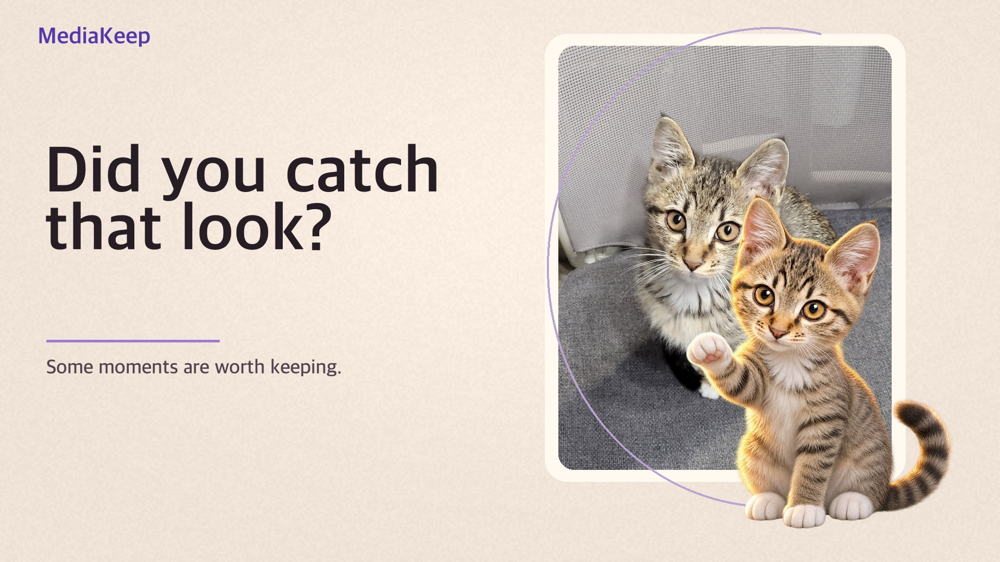
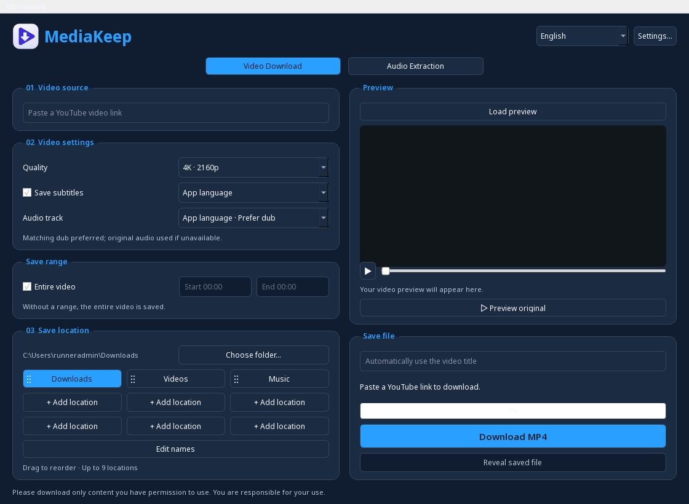
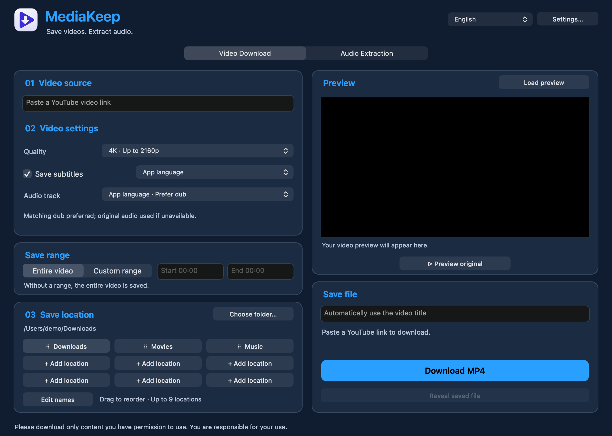
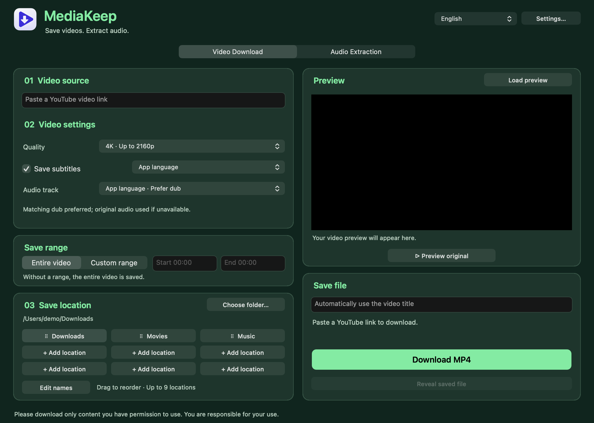

<p align="center"></p>

# MediaKeep

[English](README.md) · [日本語](docs/README.ja.md) · [한국어](docs/README.ko.md) · [简体中文](docs/README.zh-Hans.md) · [Español](docs/README.es.md) · [Français](docs/README.fr.md) · [Deutsch](docs/README.de.md) · [Português (Brasil)](docs/README.pt-BR.md)

**Download YouTube videos. Save a clip. Extract MP3 audio.**

MediaKeep is a free desktop app for **macOS, Windows, and Linux**, with **20 interface languages** and seven appearance themes.

**YouTube downloads.** Save a full YouTube video or just a selected time range as MP4. For music or other audio, extract the sound from a YouTube link and save it as MP3. Use MediaKeep with content you have permission to download or convert.

Choose your destination folder, keep the whole video or just the part you need, and let MediaKeep select the best available quality **up to your chosen limit — 4K by default**. With the language-aware defaults enabled, it also requests available subtitles and prefers dubbed audio matching your selected app language.

[Download MediaKeep 1.0.1](https://github.com/Choikuidong/MediaKeep/releases/latest) · [Step-by-step guide](docs/README.en.md) · [Sponsor development](https://github.com/sponsors/Choikuidong) 

## Watch the 42-second trailer

[](https://youtu.be/n7L9ymqGF9I)

[Watch on YouTube](https://youtu.be/n7L9ymqGF9I) · English narration and captions. The kitten makes a cameo. The app does the filing.

## What would you use it for?

| The situation | What to do in MediaKeep |
|---|---|
| The best bit of your own 50-minute recording happens at minute 47. | Enter a start and end time and save that section as an MP4. Future you can skip the scavenger hunt. |
| You recorded an interview and only need the conversation. | Open the local video in **Audio Extraction** and save the audio as an MP3. |
| Your Downloads folder has become a second desktop. | Pick the destination before saving, and pin up to nine folders for projects you return to often. |
| You have permission to save a tutorial and want to follow it in your preferred language. | Save it at the best available quality within your limit and request matching subtitles or a dubbed track when the source offers them. |

## Why MediaKeep?

### Save directly into the folder you want

Keep downloads organized from the start. Choose a destination **before** downloading, rather than moving files out of a single crowded Downloads folder afterward.

- Save tutorials, music, work references, and other permitted media into separate folders.
- Keep **up to nine favorite locations** one click away.
- Give folders your own nicknames, create new folders in the folder picker, and drag shortcuts to reorder them.
- Use **Reveal saved file** when a download is complete to find the result immediately.

### Keep only the part you need

Save a full video or specify a start and end time. For example, keep `01:20–02:45` from a longer recording as MP4 video or MP3 audio. When subtitles are saved for a clip, their timestamps are shifted to match the new file.

**Entire video** is the default: no range means the whole video is saved. A range limits the final saved clip; the app may download the full source before cutting, so network usage is not necessarily limited to the clip's duration.

### Let quality and language selection do the work

The default video setting is **4K / up to 2160p**. MediaKeep automatically selects an available video stream at or below that limit, so you do not have to choose individual download streams. Lower quality limits are available when you prefer smaller files.

With **App language** selected for subtitles and **App language · Prefer dub** selected for audio:

1. Set your interface language once.
2. MediaKeep requests source-provided subtitles for that language.
3. It prefers an available dubbed audio track in the same language.
4. If no matching dub exists, it falls back to original-marked audio, then to available audio. If subtitles are unavailable, the media can still be saved and the app reports the missing subtitles.

You can override subtitle and audio languages separately. **MediaKeep does not upscale a lower-resolution source, generate new translations, or create AI voice dubbing.** Availability depends on the original video and service.

## Downloads

| Your computer | Download | How to start |
|---|---|---|
| **macOS 13+ · Apple Silicon / M1 or later** | [Mac DMG](https://github.com/Choikuidong/MediaKeep/releases/download/v1.0.1/MediaKeep-1.0.1-macOS-arm64.dmg) | Open the DMG and drag MediaKeep into Applications. |
| **Windows 10/11 · x64** | [Windows installer](https://github.com/Choikuidong/MediaKeep/releases/download/v1.0.1/MediaKeep-1.0.1-Windows-x64-Setup.exe) · [Portable ZIP](https://github.com/Choikuidong/MediaKeep/releases/download/v1.0.1/MediaKeep-1.0.1-Windows-x64.zip) | Run Setup and open MediaKeep from the Start menu. For the portable ZIP, extract all files first. |
| Windows 11 · ARM64 | [Native ARM64 installer](https://github.com/Choikuidong/MediaKeep/releases/download/v1.0.1/MediaKeep-1.0.1-Windows-ARM64-Setup.exe) | Run Setup and open MediaKeep (ARM64) from the Start menu. |
| **Linux · x86-64 · Ubuntu 22.04+ baseline** | [Linux archive](https://github.com/Choikuidong/MediaKeep/releases/download/v1.0.1/MediaKeep-1.0.1-Linux-x86_64.tar.gz) | Extract and run `./MediaKeep/MediaKeep` in a desktop session. |

[All release files and notes](https://github.com/Choikuidong/MediaKeep/releases/latest) · [Source archive](https://github.com/Choikuidong/MediaKeep/releases/download/v1.0.1/MediaKeep-1.0.1-source.zip) · [SHA-256 checksums](https://github.com/Choikuidong/MediaKeep/releases/download/v1.0.1/SHA256SUMS.txt)

Python and the media tools do not need to be installed separately when using these packages. The Windows installer adds a Start menu shortcut and an uninstall entry without needing administrator rights. Keep the portable Windows/Linux application folder intact, including `_internal`. Mac Intel and Linux ARM64 packages are not included.

The Mac build is locally signed without Apple Developer ID notarization. The Windows build does not include an Authenticode signature, so the operating system may show a first-launch publisher warning. Check the download source before allowing the app to run.

**Upgrading from the old 1.2.x series?** Install the current release manually once. Its numeric version is lower than the legacy 1.2.x series. Subsequent updates can be checked from the new app.

## What you can save

| What you want | Where to go | Result |
|---|---|---|
| A permitted YouTube video | **Video Download** | MP4 video, up to the selected quality limit |
| Audio from your own video | **Audio Extraction → Local video** | MP3 audio |
| Audio from a YouTube link | **Audio Extraction → YouTube link** | MP3 audio |
| Only a useful section | Select a custom range | An MP4 or MP3 clip |
| Video with subtitles | Enable **Save subtitles** | Optional MP4 subtitle track and a separate SRT file |
| Audio with timed text | Enable subtitles when extracting audio | MP3 plus SRT and LRC files, when subtitles are available |
| An available dubbed track | Select **Audio track** | Media using the preferred source-provided language track |

Video quality limits: **2160p / 1080p / 720p / 480p**. MP3 bitrates: **320 / 192 / 128 kbps**, with 192 kbps selected by default. Higher bitrates generally use more storage.

## Screenshots · English interface

These screenshots show the actual app with English selected. The preview panes are empty until you load a source.

### Video download


### Audio extraction


### Windows and Linux

| Windows desktop | Linux desktop |
|---|---|
|  |  |

## Your first download

1. Open **Video Download** and paste a single YouTube video link you have permission to download.
2. Select **Load preview** to check the title and source thumbnail. **Preview original** opens the original page in your browser.
3. Keep the default quality and language settings, or choose your own quality limit, subtitles, and audio track.
4. Leave **Entire video** selected, or enter start and end times for a custom range.
5. Choose the destination folder. Check the automatically suggested file name or enter your own.
6. Select **Download MP4**. Watch the percentage and status; you can cancel an active task.
7. When complete, select **Reveal saved file**. On Linux this opens the containing folder; on Windows it selects the file in Explorer.

For MP3, switch to **Audio Extraction**, choose a local video or a YouTube link, select the bitrate, then choose **Extract MP3**. You can select an existing SRT, VTT, ASS, or SSA subtitle file; a selected local subtitle file takes priority over online subtitles for audio extraction.

## Twenty interface languages

| | | | |
|---|---|---|---|
| English | Korean | Japanese | Simplified Chinese |
| Traditional Chinese | Spanish | French | German |
| Portuguese (Brazil) | Italian | Russian | Indonesian |
| Dutch | Polish | Turkish | Ukrainian |
| Vietnamese | Swedish | Czech | Romanian |

English is the default. Change the language in **Settings → App Language**; your selection is saved locally. Noto fonts are included in Windows/Linux packages for reliable multilingual display.

The interface, main task statuses, update prompts, and app-authored errors are localized. Source titles, custom folder names, native OS dialogs, external-tool diagnostics, and release notes are not automatically translated.

## Seven appearance themes

Choose **Settings → Appearance**. Soft Light is the default. The other choices are Midnight Blue, Warm Amber, Forest Green, Lavender Night, Ocean Teal, and Peach Cream.

| Midnight Blue | Warm Amber |
|---|---|
|  |  |
| **Soft Light** | **Forest Green** |
|  |  |

## Preview, progress, and file handling

- The app shows download progress and task status, and supports cancelling active work.
- On macOS, a short muted preview may be prepared from incoming video data. Windows/Linux show the source thumbnail and progress, then can play the saved local media.
- **Preview original** opens the source page or original file. **Reveal saved file** locates the completed result.
- Existing destination files trigger a replacement confirmation. Attempts to save over a selected original video or subtitle are blocked.
- Work is staged in a temporary folder before completed outputs are installed. Settings and favorite folders stay on your computer.

## Updates

MediaKeep checks **stable GitHub Releases** at launch and daily while it is running. You can also select **Check for Updates…** from the app menu.

A newer supported release offers **Download Update**, **Later**, or **Skip This Version**. A source-code edit alone does not trigger an update notification: a higher numeric stable release and an uploaded package for your operating system must be available. After downloading, quit and replace the app yourself. No background service or silent installer is installed.

## Support development

MediaKeep is free to download and use. If it saves you time, you can help fund maintenance, compatibility fixes, language improvements, and future features.

**[Sponsor Choi Kuidong on GitHub Sponsors](https://github.com/sponsors/Choikuidong)**

The public sponsor page offers monthly and one-time options. Sponsorship is optional and does not unlock paid features or change the free download. GitHub handles the available payment options and checkout.

You can also use **Support on GitHub** in the app settings or the **Sponsor** button on this repository. The Korean interface also shows a KakaoPay QR code in Settings. Supporting the project is not required to use the app.

## Help and troubleshooting

- **The output is below 4K:** the source must provide 4K. The selected setting is a maximum; MediaKeep does not create missing resolution.
- **The original voice is used:** a matching dubbed track may not exist. Changing the interface language does not create a new dub.
- **No subtitles appear:** check source availability and your selected language. Enable the optional subtitle track in your MP4 player, or open the separate SRT file. Automated captions may contain errors.
- **A download fails:** check the link, source availability, and network. Service changes may require an app update. DRM and private, paid, login, age, or region restrictions are not bypassed.
- **Windows does not start:** extract the full ZIP and keep `_internal` beside the executable.
- **Linux does not start:** use a desktop session and install the display/audio libraries listed in the [guide](docs/README.en.md#linux).
- **A clip still downloads a large file:** a range controls the saved result, not necessarily how much of the original must be fetched first.

[Read the complete installation and user guide](docs/README.en.md)

## Release checks

| Platform | Checks performed |
|---|---|
| macOS Apple Silicon | 280 rendered combinations of 20 languages, seven themes, and two tabs; visible action/folder buttons; actual MP3/SRT/LRC conversion; subtitle timing and update-version checks |
| Windows x64 | Source and frozen EXE checks on a Windows runner; translation glyph coverage; themes and tabs; actual FFmpeg conversion, trimmed MP4 with subtitles, preview loading, cancellation, and automatic file naming |
| Linux x86-64 | Source and frozen executable checks on Ubuntu 22.04 with the same conversion, subtitle, preview, font, and cancellation checks |

[View the verified Windows/Linux build](https://github.com/Choikuidong/MediaKeep/actions/runs/45370278831)

These tests use generated local media. They are not a claim that every online video, codec, distribution, or hardware configuration has been tested. Online behavior can change with the source service.

## Build from source

### macOS / Apple Silicon

Install Xcode Command Line Tools and Python 3, then run:

```sh
bash scripts/build.sh
bash scripts/package.sh
```

### Windows / Linux x86-64

Use Python 3.12 on the target operating system:

```sh
python -m venv .venv
# Windows: .venv\Scripts\activate
# Linux: source .venv/bin/activate
python -m pip install -r Desktop/requirements.txt
python Desktop/build.py
```

The **Build Windows and Linux** GitHub Actions workflow also builds on the actual target operating systems and tests the resulting executables. The **Attach verified desktop packages** workflow attaches packages from a successful build to an existing draft release.

See [publishing guidance](.github/PUBLISHING.md) for the English-only GitHub content policy and release checklist.

## Source layout

| Path | Purpose |
|---|---|
| `Sources/` | Native macOS interface, media workflows, subtitles, and update checks |
| `Desktop/mediakeep.py` | Windows/Linux interface and user flow |
| `Desktop/core.py` | Media download, conversion, subtitle handling, and release checks |
| `Desktop/verify.py` | Generated-media workflow and interface checks |
| `Resources/Languages.json` | Language, subtitle, audio, and metadata mappings |
| `Resources/Translations.json`, `Strings.json` | Bundled translations |
| `.github/workflows/` | Target-platform build, test, and package-attachment workflows |
| `docs/` | User guide and real app screenshots |
| `Licenses/` | Third-party license texts and notices |

## Privacy and responsible use

Preferences are stored locally. Downloading contacts the original service; update checks contact GitHub. MediaKeep does not require a separate account or operate its own analytics or cloud-sync service.

Download or convert only content you have permission to use. Check the source service's terms and the rights holder's permission. Download functionality does not grant copying, editing, redistribution, or commercial-use rights. You are responsible for your use.

## Credits and third-party components

Packages include FFmpeg, yt-dlp, and Deno; Windows/Linux also use PySide6/Qt and imageio-ffmpeg. Noto Sans and Noto Sans CJK fonts are included for multilingual display. Their notices and licenses are in `Licenses`. Qt is distributed as replaceable dynamic libraries.

- [Qt/PySide source](https://code.qt.io/pyside/pyside-setup.git)
- [yt-dlp source](https://github.com/yt-dlp/yt-dlp)
- [FFmpeg source](https://ffmpeg.org/download.html)
- [imageio-ffmpeg build project](https://github.com/imageio/imageio-ffmpeg)
- [Deno source](https://github.com/denoland/deno)

Source publication alone does not grant a new open-source license to MediaKeep. Third-party components retain their respective licenses.

**© 2026 Apple Craft. All rights reserved.**
