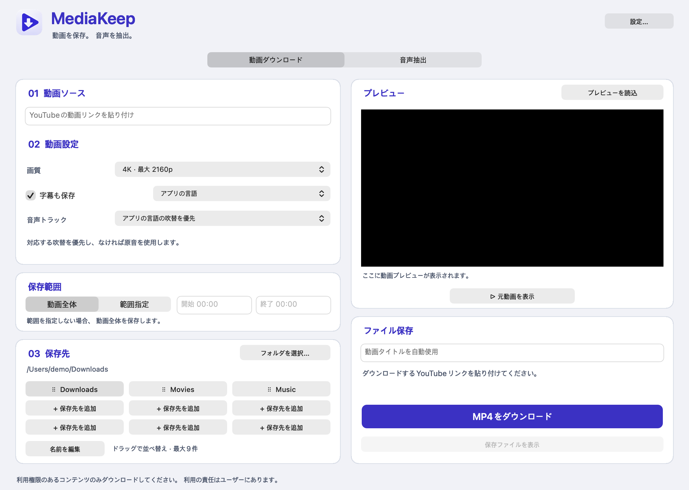
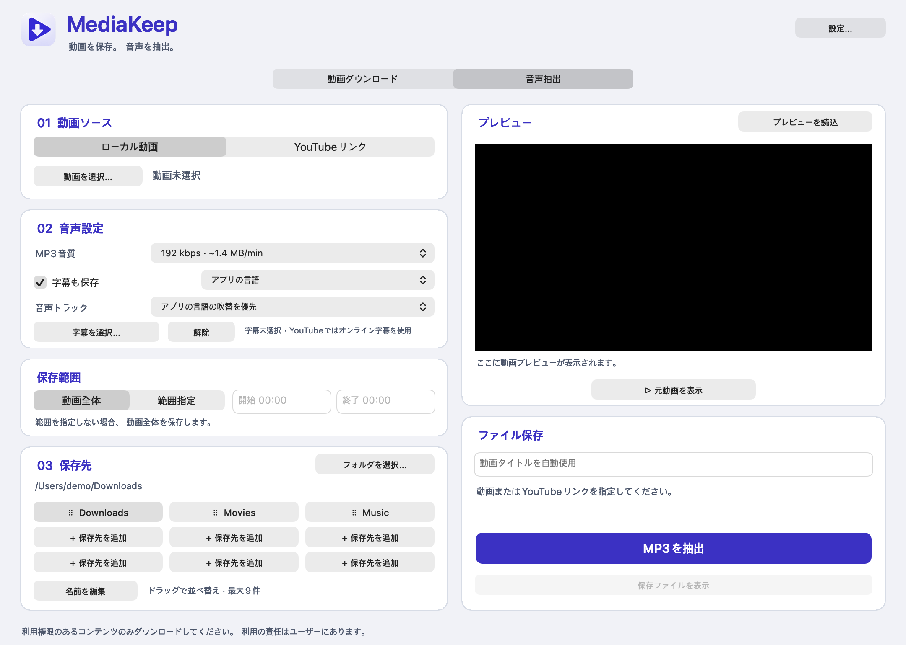

# MediaKeep

[English](../README.md) · [日本語](README.ja.md) · [한국어](README.ko.md) · [简体中文](README.zh-Hans.md) · [Español](README.es.md) · [Français](README.fr.md) · [Deutsch](README.de.md) · [Português (Brasil)](README.pt-BR.md)

**動画保存とMP3抽出を、もっと手軽に。**

MediaKeepは、macOS・Windows・Linuxで使える無料のデスクトップアプリです。長いチュートリアルの見返したい場面や、自分で録画したインタビューの音声を、指定したフォルダに保存できます。日本語を含む20の表示言語と7つのテーマに対応しています。

**YouTubeから保存**：動画全体や指定した区間をMP4で保存できます。音楽など音声だけが必要な場合は、YouTubeのリンクからMP3として保存できます。

[英語の紹介動画](https://youtu.be/n7L9ymqGF9I)

## できること

- よく使う保存先を最大9件登録。プロジェクトごとに保存先を変えられるので、ダウンロードフォルダの大捜索を減らせます。
- 動画全体をMP4で保存するか、開始・終了時刻を指定して必要な部分だけ残せます。手元の動画や対応リンクからのMP3抽出にも対応します。
- 初期設定は最大4K（2160p）です。設定した上限以下で利用できる最高画質を選びます。日本語の字幕や吹き替えが配信元にあれば、設定に応じて優先できます。

## ダウンロード

- [macOS 13+ · Apple Silicon (DMG)](https://github.com/Choikuidong/MediaKeep/releases/download/v1.0.1/MediaKeep-1.0.1-macOS-arm64.dmg)
- [Windows 10/11 · x64 (Setup EXE)](https://github.com/Choikuidong/MediaKeep/releases/download/v1.0.1/MediaKeep-1.0.1-Windows-x64-Setup.exe)
- [Windows 11 · ARM64 (Setup EXE)](https://github.com/Choikuidong/MediaKeep/releases/download/v1.0.1/MediaKeep-1.0.1-Windows-ARM64-Setup.exe)
- [Linux · x86-64 (tar.gz)](https://github.com/Choikuidong/MediaKeep/releases/download/v1.0.1/MediaKeep-1.0.1-Linux-x86_64.tar.gz)

[GitHub Releases](https://github.com/Choikuidong/MediaKeep/releases/latest) · [SHA-256](https://github.com/Choikuidong/MediaKeep/releases/download/v1.0.1/SHA256SUMS.txt)

## 使い方

macOSではDMGを開いてアプリを「アプリケーション」へ移動します。WindowsではPCに合ったセットアップを実行し、スタートメニューから開きます。Linuxではアーカイブを展開してMediaKeepを実行します。

**Settings → App Language** で「日本語」を選びます。動画を保存する場合は「動画ダウンロード」でリンクを入力し、必要であれば区間を指定して、保存先を選びます。音声のみなら「オーディオ抽出」を使います。

## ご利用について

字幕・吹き替えは配信元が提供するものを使用します。アップスケール、新規翻訳、音声合成は行いません。区間保存でも、処理に元の動画全体の取得が必要な場合があります。保存・変換の許可があるコンテンツにのみご利用ください。

[GitHub Sponsors](https://github.com/sponsors/Choikuidong)
